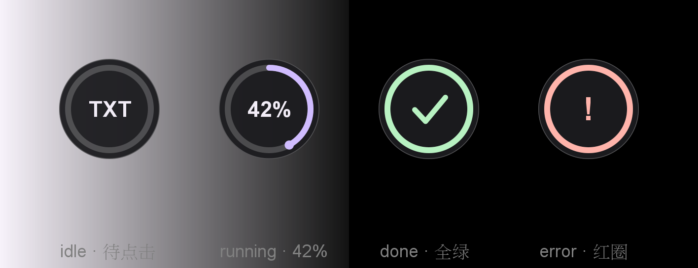

# FqFetch — 番茄免费小说整本 TXT 导出

阅读页注入**悬浮窗**（圆形进度环），点击按「批量接口 + RxJava 并发」拉取章节、本地解密、顺序写入单个 TXT。
模块自带 **Material 3 Expressive** 设置页，参数改动即时生效。

## 1. 工程结构

```
app/src/main/java/com/cownow/fqfetch/
├── HookEntry.java      LSPosed 入口（assets/xposed_init 指定）；hook ReaderActivity#onResume/onDestroy
├── Hosts.java          宿主类解析与调用（fu8.a$a、ChapterOriginalContentHelper、BatchFullRequest …）
├── FqFetchTask.java    主体流程：组批 → merge 并发 → 解密 → 按序写盘 → 驱动悬浮窗进度（工作线程）
├── FloatingPanel.java  悬浮窗容器：拖动 / 吸附 / 位置记忆 / 长按隐藏 / 点击导出 / 状态机
├── RingProgressView.java  自绘圆环：轨道 + 进度弧 + 呼吸进度头 + 百分比 / TXT / 对勾 / 感叹号
├── ReaderUi.java       每 Activity 一个悬浮窗（WeakHashMap），转发进度/完成/出错并转主线程
├── FloatPos.java       悬浮窗位置比例（存在宿主 prefs）
├── Prefs.java          设置项：默认值/范围/模块侧写入/宿主侧 XSharedPreferences 读取
├── Ref.java            反射工具（rfGet / rfSet / rfStaticField / rfStaticMethod）
├── D.java              errText / safeName / stripTitle / toPlain
├── L.java              logcat + 文件日志（可关）+ 主线程 Toast（对应脚本 log / dlog / toast）
├── Cfg.java            输出目录探测（自定义目录优先）+ 日志路径
└── MainActivity.java   设置页（M3 Expressive）

app/src/main/res/layout/activity_main.xml   设置页布局
app/src/main/assets/xposed_init
app/src/main/resources/META-INF/xposed/{module.prop,scope.list,java_init.list}
app/src/main/keepRules/rules.keep
app/src/test/java/com/cownow/fqfetch/{PortTest,PrefsContractTest,ThreadSafetyContractTest}.java
```

## 2. 阅读页悬浮窗

替换原脚本塞进 `decorView` 的 `Button + ProgressBar`：一个 68dp 圆形悬浮窗，内含自绘进度环。
**不需要悬浮窗权限**（画在宿主 Activity 的 decorView 上），也不依赖宿主主题（纯 `Canvas` + `GradientDrawable`）。



> 上图由同一套几何/配色参数在 Java2D 里复现（`build/preview/RingPreview.java`），用于校验比例与配色，非设备截图。

| 交互 | 行为 |
| --- | --- |
| 单击 | 开始导出；下载中单击只提示「正在下载中」 |
| 拖动 | 自由移动，松手吸附到最近的左/右边缘（180ms 减速动画） |
| 长按 | 480ms 触发，震动反馈 + 隐藏（重新进入阅读页恢复） |
| 位置记忆 | 松手后按比例写入宿主 `SharedPreferences("fqfetch_ui")`，重进阅读页按比例还原 |

状态机（`RingProgressView.MODE_*`）：

| 状态 | 圆环 | 中心 | 进入时机 |
| --- | --- | --- | --- |
| IDLE | 仅轨道 | `TXT` | 注入后 / 完成后 2.6s 回位 |
| RUNNING | 紫色进度弧 + 呼吸圆点 | 百分比 | 每波结束 `ReaderUi.setProgress(done,total)` |
| DONE | 整圈绿色 | 路径绘制的对勾 | 全部章节写完且无失败章节 |
| ERROR | 整圈红色 | `!` | 提前失败（ReaderClient/目录/bookId 为空、写文件失败、下载中断）或存在失败章节 |

透明度由设置项「悬浮窗不透明度」控制（`Prefs.buttonAlpha`，注入时读取）。

## 3. 设置页（M3 Expressive）

主题：`Theme.Material3Expressive.DayNight.NoActionBar`（MDC 1.14.0），`onCreate` 里
`DynamicColors.applyToActivityIfAvailable(this)` 做动态取色（Android 12+ 生效，低版本回落静态 M3 调色板）。
组件：`Widget.Material3Expressive.Button(.OutlinedButton)`、`MaterialToolbar`、`MaterialCardView`(Filled)、
`MaterialSwitch`、`Slider`、`TextInputLayout`(OutlinedBox)；`targetSdk 37` 强制边到边，用
`ViewCompat.setOnApplyWindowInsetsListener` 吃 `systemBars | displayCutout`。

| 卡片 | 控件 | 作用 | 默认 | 范围 |
| --- | --- | --- | --- | --- |
| 下载 | Slider | 每批章节数 `BATCH_SIZE` | 15 | 5–20 |
| 下载 | Slider | 并发批次数 `PARALLEL` | 4 | 1–8 |
| 下载 | Slider | 每波章节数 `WAVE_SIZE` | 30 | 10–100（步长 10） |
| 输出 | TextInput | 自定义输出目录（留空＝自动探测） | 空 | 任意可写目录 |
| 输出 | Switch | 文件名追加「作者」 | 关 | — |
| 正文 | Switch | 去掉重复的章节标题（`stripTitle`） | 开 | — |
| 正文 | Switch | 正文 HTML 转纯文本（`toPlain`） | 开 | — |
| 调试与外观 | Switch | 写 `_fqfetch_debug.log` | 开 | — |
| 调试与外观 | Slider | 悬浮窗不透明度 | 70% | 10–100% |

按钮：`恢复默认`、`打开 LSPosed`。改动 250 ms 防抖自动保存，`onPause` 兜底，底部显示「已自动保存 · HH:mm:ss」。

### 配置如何跨进程生效

| 方向 | 位置 | 实现 |
| --- | --- | --- |
| 写 | 模块进程 `com.cownow.fqfetch` | `Prefs.save()` → 自身 `SharedPreferences("fqfetch")`，commit 后 `setReadable(true,false)` + `XSharedPreferences.makeWorldReadable()` |
| 读 | 宿主进程 `com.dragon.read` | `Prefs.refresh()` → `XSharedPreferences("com.cownow.fqfetch","fqfetch")`；失败退回直读 `/data/user_de/0/.../shared_prefs/fqfetch.xml` |
| 生效时机 | — | `handleLoadPackage`（进程启动）、`FqFetchTask.run()`（每次点悬浮窗）、注入悬浮窗时读透明度 |
| 悬浮窗位置 | 宿主进程自己的 prefs | `FloatPos`（模块进程无法写宿主数据目录） |

### 环境自检（Android 12 排查用）

设置页第二张卡片「环境自检」只读地列出：Android 版本/API/ABI、模块版本与 targetSdk、是否检测到 su/Magisk、
`com.dragon.read` 是否可见（版本号）、LSPosed 管理器是否可见、配置文件大小与可读性、日志实际路径、以及
`TxtOutput.describePlan()` 给出的落地计划。宿主进程里的 hook 是否生效无法跨进程查询，需看 logcat。

## 4. 构建 / 验证

```powershell
$env:JAVA_HOME="C:\Program Files\Android\Android Studio\jbr"
.\gradlew.bat :app:assembleDebug        # app/build/outputs/apk/debug/app-debug.apk
.\gradlew.bat :app:assembleRelease      # app/build/outputs/apk/release/app-release-unsigned.apk
.\gradlew.bat :app:testDebugUnitTest    # 20 项全绿（PortTest 8 + Prefs 5 + ThreadSafety 3 + TxtOutput 3 + 模板 1）
.\gradlew.bat :app:lintDebug            # 0 error
```

## 5. 安装与使用

1. 安装 APK → LSPosed 启用模块（作用域已由 `xposedscope` 预置 `com.dragon.read`）。
2. 打开 FqFetch 设置页按需调整（顺便看一眼「环境自检」）→ 强制停止番茄（或重启手机）。
3. 打开任意一本书的阅读页 → 右上出现圆环悬浮窗（默认贴右、纵向 35%）→ 单击导出。
4. 校验：

```powershell
adb logcat -s Xposed | Select-String FqFetch
# 期望依次出现：加载 com.dragon.read / 配置 batch=… / 已 Hook ReaderActivity#onResume / 悬浮窗已注入 / 输出目标: …
adb shell tail -n 50 /sdcard/Android/data/com.dragon.read/files/FqFetch/_fqfetch_debug.log
adb shell ls -l /sdcard/Download/FqFetch/TXT/        # API 29+ 走 MediaStore 时的落地位置
```

## 6. 输出目录

设置项里的自定义目录优先（探测可写后使用）；留空或不可写则按下列顺序探测：

只能靠 logcat 判定的部分：

```powershell
adb logcat -c; adb shell am force-stop com.dragon.read
# 打开番茄进阅读页后再看：
adb logcat -s Xposed | Select-String 'FqFetch|LSPosed'
```

- 出现 `加载 com.dragon.read` → 模块被注入；没有 → 作用域 / 激活 / root 三者有一个没成。
- 有 `已 Hook ReaderActivity#onResume（n 处）` 但无 `悬浮窗已注入` → 注入失败，看附近的 `注入悬浮窗失败: …` 原因。
- 有 `批量接口可用=false` → 宿主版本改名，按 `Hosts.NAME_*` 更新；单章兜底仍能出全本。

## 7. 常见失败分支

| 现象 | 定位 | 处理 |
| --- | --- | --- |
| 点悬浮窗后 Toast `Animators may only be run on Looper threads` | v2.1 线程 bug，v2.2 已修 | 升级 v2.2；若复现，检查三处主线程守卫是否被改掉（`ThreadSafetyContractTest` 会报） |
| 悬浮窗不出现 | logcat 无 `悬浮窗已注入` | 无 `已 Hook ReaderActivity#onResume` → 改 `Hosts.NAME_READER_ACTIVITY`；decorView 非 FrameLayout 会写日志 |
| 悬浮窗被误触隐藏 | 长按触发 | 退出重进阅读页即恢复 |
| 悬浮窗位置跑到屏幕外 | 换分辨率/旋转后 | 已在 `onLayoutChange` 里钳制回边界；位置存于宿主 prefs `fqfetch_ui`，清数据即回默认 |
| 圆环进度不动 | 宿主批量接口不可用 | 看日志 `批量接口可用=false`，单章兜底仍会推进度 |
| 设置页打不开 / 主题崩 | `Theme.Material3Expressive.*` 由 material 1.14 提供 | 确认依赖未降级 |
| 改了设置宿主没反应 | logcat `配置 batch=…` 是否新值 | 确认模块 prefs 可读；必要时强制停止宿主 |
| `未获取到 ReaderClient` | 阅读页字段 `K` 改名 | 换字段名或用 getter（`Ref.read`） |
| `批量取回 0 章` | `批量接口可用=false` | 更新 `Hosts.NAME_CHAPTER_REQ` / `NAME_BATCH_API_IMPL` / `NAME_BATCH_REQ` |
| Download 写入被拒 | 分区存储 | v2.3 起自动走 MediaStore；也可在设置页指定目录 |

## 10. 变更记录

| 版本 | 内容 |
| --- | --- |
| 2.0 | BeanShell 脚本移植为 LSPosed 模块（按钮 + 横向进度条） |
| 2.1 | 设置页改 M3 Expressive；9 项设置经 XSharedPreferences 生效；按钮/进度条换成圆形悬浮窗 |
| 2.2 | 修 `Animators may only be run on Looper threads`（三层转主线程）；新增 `ThreadSafetyContractTest`；中断不再误报完成 |
| 2.3 | Android 12 兼容：`xposedminversion`/`minApiVersion` 93→82；补 `<queries>` 包可见性；新增 `TxtOutput`（MediaStore 落公共下载）；`values-v31` SplashScreen；显式 `setDecorFitsSystemWindows(false)`；日志改宿主外部私有目录；设置页新增「环境自检」 |
